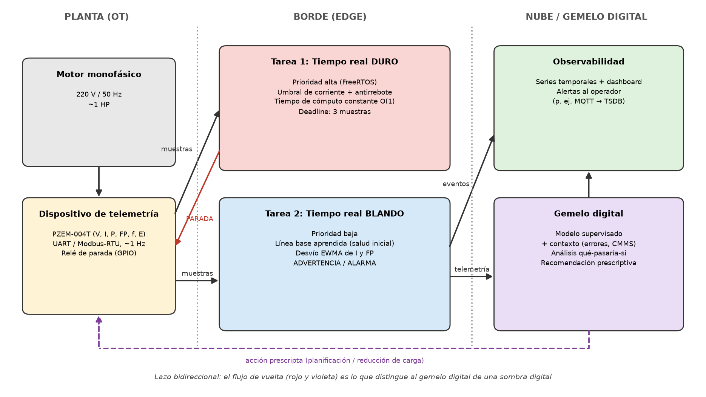

# SIDEM – Detección de desgaste abrupto y parada de emergencia en motores con Edge Computing

Trabajo final de **Sistemas en la Industria 4.0 (SI40)** – UTN Facultad Regional La Plata.
Romeo Monfroglio y Emiliano Di Grappa.

Proponemos usar el dispositivo de telemetría ESP32 + PZEM-004T como **nodo Edge**: una regla simple y
garantizada detiene el motor ante un desgaste abrupto (tiempo real duro), y un detector de anomalías envía
alertas tempranas a un gemelo digital en la nube (tiempo real blando). La simulación pone a prueba esa idea con
datos propios y con el dataset público *Azure Predictive Maintenance*.



## Contenido

| Carpeta | Qué hay |
| --- | --- |
| [`informe/`](informe) | Informe final (Word y PDF) |
| [`simulacion/`](simulacion) | Código de la simulación, pruebas, resultados y tablero. Ver su [README](simulacion/README.md) |

## Resultados principales

- El camino duro detuvo el motor a tiempo en **50 de 50** fallas abruptas simuladas.
- Con datos externos, solo **16 de cada 100** alertas del detector simple eran fallas reales: por eso la
  parada nunca la decide el detector.
- Sumar el historial de errores y mantenimiento de la máquina baja las falsas alarmas de **28,8 a 3,9** por motor
  por año, lo que vuelve rentable al mantenimiento predictivo.

## Cómo correrlo

```bash
cd simulacion
pip install numpy pandas matplotlib scikit-learn pytest
python download_data.py
python dashboard.py
```

El tablero se abre en el navegador y tiene botones para correr cada parte de la simulación.
